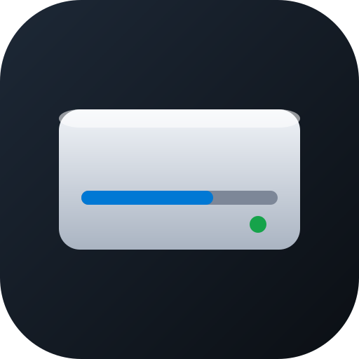

# dsh-disk-manager

English | [中文](README.zh.md)

Browse local disks from the DeepSeek Harness right sidebar, following the logic of Windows Disk Management / File Explorer: volume overview, folder browsing, folder size accounting, desktop shortcuts, and hover previews.

> Windows only. Read-only browsing plus delete-to-Recycle-Bin. **No partition operations** (extend / shrink / format are not implemented).



## Features

- **Volume overview** — every drive laid out like "This PC": drive glyph, `Label (X:)`, used-space bar, `X free of Y`
- **Folder browsing** — enter any directory; sort by name / size / modified time / type; group; detailed or compact density
- **Address bar** — click to turn it into an input, type a path, press Enter
- **Folder size on demand** — right-click a folder to measure it; deadline-guarded so the UI never hangs
- **Open by type** — text, code, images, PDF, Office go to the built-in sidebar preview; video, audio, and archives go to the system default program
- **Desktop dock** — desktop contents are laid out inline under the volume list; shortcuts show the real application icon
- **Hover peek** — rest the pointer on a folder and a floating panel shows its contents, up to three levels, with drill-down
- **Multiple panes** — "Open in new tab" gives each panel its own drive and its own remembered location
- **Delete** — right-click a file or folder, confirm once, it goes to the Recycle Bin

## Install

### From the plugin market

Add this index source in DSH Settings → Plugin Market:

```
https://ananpng123.github.io/dsh-disk-manager/index.json
```

Then search for `disk` on the Discover page and install.

### From a local directory

```bash
# inside DSH, via the plugin manager
plugin_manager install_bundle <path-to>dsh-disk-manager
```

**Restart DSH once** after installing; the "Disk" entry then appears in the sidebar.

> The plugin has two halves: `index.js` runs in the DSH host process, `client.js` runs in the browser. **Changing `index.js` requires a DSH restart**; a page refresh only reloads `client.js`.

## Usage

1. Click "Disk" in the session header — the disk panel opens in the right sidebar
2. Click a volume card to enter it, or type a path into the address bar
3. Right-click a file or folder: open, open in new tab, open in terminal, reveal in Explorer, properties, delete
4. Right-click a volume card: open, open in new tab, disk checkup (copies a prompt and starts a new conversation), properties

## Compatibility

| Item | Requirement |
|---|---|
| OS | Windows 10 / 11 |
| DSH | `>=0.2.1-rc.5` (tested version) |
| PowerShell | Windows PowerShell 5.1 (bundled with Windows) |
| Dependencies | None |

## Known limitations

- **Windows only** — the host half depends entirely on Windows APIs and PowerShell
- **No partition operations** — extend, shrink, and format are not offered
- **No permanent delete** — deletion always goes through the Recycle Bin
- **No rename or undo** — hence no "undo rename" in the context menu either
- **No auto refresh** — changes on disk need a manual refresh
- **Icons** — resolved through `SHGetFileInfo`, which covers UWP and classic apps; a rare misregistered AppX package may fall back to a generic icon
- **PowerShell disabled** — icons degrade to file-type icons; everything else keeps working

## Layout

```
dsh-disk-manager/
├── package.json        # manifest, bundle patch, client inject
├── cordis.patch.yml    # inserts the host half
├── index.js            # host half: HTTP endpoints (/api/dsh-disk)
├── client.js           # client half: sidebar tab, menus, floating panels
├── icon.svg            # plugin icon
├── index.json          # plugin market index (format 1)
├── test/               # smoke test + index validation
└── ACCEPTANCE-*.md     # acceptance reports
```

Host endpoints: `volumes` `ls` `size` `open` `reveal` `terminal` `mkdir` `info` `cleanup` `clipboard` `icons` `trash` `settings`.

## Development

```bash
# syntax check
node --check index.js && node --check client.js

# smoke test: calls the host handlers directly, no running DSH needed
npm test

# market index validation: runs the host's own parseMarketIndex
npm run test:market
```

`npm test` builds a sandbox in the system temp directory and runs 7 checks — volume enumeration, directory listing, folder size, create folder, duplicate-name message, file properties, empty-path rejection — then cleans up.

`npm run test:market` reads `index.json` and validates it with the `@deepseek-ai/dsh-plugin-market-index` copy shipped with DSH: field rules, relative icon resolution, and the generated install spec. Failures report the JSON path of the offending value.

## License

MIT
