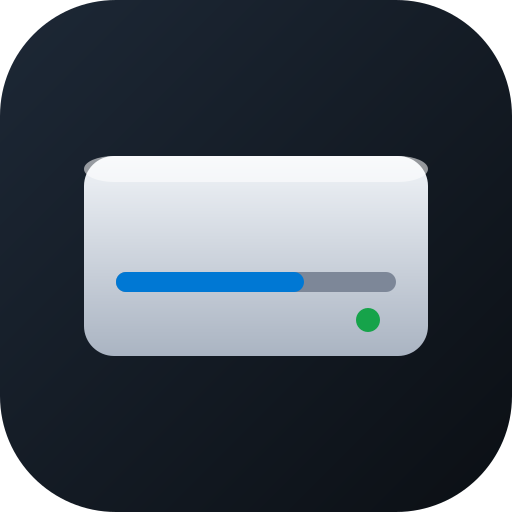

# dsh-disk-manager

[English](README.md) | 中文

在 DeepSeek Harness 右侧栏按「磁盘管理 / 资源管理器」的逻辑浏览本地磁盘：卷总览、目录浏览、目录大小统计、桌面快捷入口与预览。

> 仅支持 Windows。浏览 + 恰好两种写操作：删除（一律进回收站）与新建文件夹，**不做任何分区操作**（扩容 / 压缩 / 格式化）。



## 功能

- **卷总览**：按「此电脑」的排法显示每块盘——盘体图标、`卷标 (盘符)`、已用进度条、`X 可用，共 Y`
- **目录浏览**：进入任意目录，支持排序（名称/大小/修改时间/类型）、分组、详细/紧凑两种密度
- **地址栏**：点一下变输入框，直接输入路径回车跳转
- **目录大小统计**：右键目录按需统计，带时限保护，不会卡住界面
- **按类型打开**：文本/代码/图片/PDF/Office 交给右栏内置预览；视频、音频、压缩包等直接交给系统默认程序
- **桌面快捷区**：桌面内容直接铺在卷列表下半区，快捷方式显示应用真图标
- **悬停预览**：鼠标停在文件夹上，右侧浮层显示内容，最多三级，支持级联与下钻
- **多开**：右键「在新标签页打开」，两个面板可以停在不同盘上，各自记住位置
- **删除**：文件/文件夹右键删除，二次确认，只进回收站
- **新建文件夹**：目录内空白处右键，输入名字就地创建；重名只提示，不覆盖

## 安装

### 从插件市场安装

在 DSH 设置 → 插件市场的索引源里添加：

```
https://ananpng123.github.io/dsh-disk-manager/index.json
```

然后在发现页搜索 `disk`，点安装。

### 从本地目录安装

```bash
# 在 DSH 里通过插件管理器安装（本地目录或包）
plugin_manager install_bundle <path-to>dsh-disk-manager
```

安装后**重启一次 DSH**，会话头会多出两个按钮——详见下文「装完之后看哪里」。

> 插件分两半：`index.js` 跑在 DSH 宿主进程，`client.js` 跑在浏览器。**改动了 `index.js` 必须重启 DSH**，刷新页面只能更新 `client.js`。

## 收录状态

已向两个社区索引提交，都在等审核：

| 索引 | 提交 | 状态 |
|---|---|---|
| awesome-dsh-plugin | [PR #11387](https://github.com/awesome-dsh-plugin/awesome-dsh-plugin/pull/11387) | open，CI 全绿，改动 +7/-0 |
| 开放插件市场（dshopen.org） | [issue #200](https://github.com/polang233/dsh-plugin-index/issues/200) | open，走 Git 来源（尚未发 npm） |

两个都合并之前，直接按 tag 装：

```bash
git+https://github.com/Ananpng123/dsh-disk-manager.git#v0.4.3
```

插件自带的索引托管在 <https://ananpng123.github.io/dsh-disk-manager/index.json>，把它加进 Discover 的索引源就能立刻看到这条收录。

## 使用

**装完必须重启一次 DSH。** 宿主侧要注册 HTTP 路由（`/api/dsh-disk`），重启才会挂上；没重启时任何操作都会提示「后端未就绪」。界面侧有热更新，宿主侧没有。

### 装完之后看哪里

重启后看**会话头**——输入框上方那一排小图标。那里多了两个按钮：

| 图标 | 悬停提示 | 点开是什么 |
|---|---|---|
| 显示器 | 桌面文件 | 你的桌面目录，右栏打开，文件夹可就地展开 |
| 层叠文件夹 | 工作区文件 | 当前工作区里每次对话产出的文档，按会话分组 |

两个都是右栏 tab，可以同时开好几个。

### 磁盘面板

1. 点显示器图标进入卷列表（已经开着磁盘面板时点任意卷卡片也行）
2. 点卷进入，或在地址栏输入路径回车
3. 点文件夹就地展开，双击则整页进入
4. 右键文件或文件夹：在面板里预览、用系统程序打开、在资源管理器中显示、复制路径、删除（只进回收站）
5. 右键卷卡片：打开、在新标签页打开、磁盘体检、属性

### 工作区文件面板

1. 点层叠文件夹图标
2. 列表按会话分组、最近的在最上；点分组标题可以折叠展开
3. 点文档用 DSH 内置预览打开；右键可以用系统程序打开、定位、复制路径、删除
4. 搜索框按文件名跨所有分组过滤

## 兼容性

| 项 | 要求 |
|---|---|
| 系统 | Windows 10 / 11 |
| DSH | `>=0.2.1-rc.5`（实测版本） |
| PowerShell | Windows PowerShell 5.1（系统自带） |
| 依赖 | 无第三方 npm 依赖 |

## 已知限制

- **仅 Windows**：host 半全部依赖 Windows API 与 PowerShell，其它平台整个插件不工作
- **不做分区操作**：不提供扩容、压缩、格式化
- **无永久删除**：删除一律进回收站
- **无重命名 / 撤销**：因此右键菜单里也没有「撤销重命名」
- **不自动刷新**：磁盘内容变化需要手动刷新
- **图标**：走 `SHGetFileInfo`，UWP 与普通程序均可；极少数注册异常的 AppX 可能显示通用图标
- **PowerShell 被禁用时**：图标退化为文件类型图标，其余功能不受影响

## 结构

```
dsh-disk-manager/
├── package.json        # 插件清单、bundle patch、client inject
├── cordis.patch.yml    # 插入 host 半
├── index.js            # host 半：HTTP 端点（/api/dsh-disk）
├── client.js           # client 半：右栏 tab、菜单、浮层
├── icon.svg            # 插件图标
├── index.json          # 插件市场索引（格式 1）
├── test/               # 冒烟自检 + 索引校验
└── ACCEPTANCE-*.md     # 验收报告
```

host 端点：`volumes` `ls` `size` `open` `reveal` `terminal` `mkdir` `info` `cleanup` `clipboard` `icons` `trash` `settings`。

## 开发

```bash
# 语法检查
node --check index.js && node --check client.js

# 冒烟自检：直接调宿主侧 handlers，不需要启动 DSH
npm test

# 市场索引校验：用宿主自带的 parseMarketIndex 跑一遍
npm run test:market
```

`npm test` 在系统临时目录建沙箱，跑 7 项：卷枚举、目录列举、目录大小、新建、重名文案、文件属性、空路径拦截，跑完自动清理。

`npm run test:market` 读取 `index.json`，用 DSH 安装目录里的 `@deepseek-ai/dsh-plugin-market-index` 校验字段、相对图标解析与安装参数，缺字段或写错会在报错里给出 JSON 路径。

## 许可证

MIT
